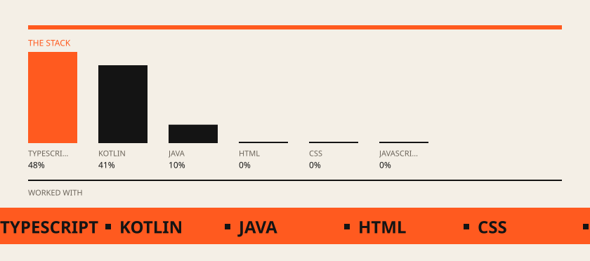

# Horizon

Rendered by Readmint with live data of MrLarkyy. Designs with the personal texts filled in are in [designs/](designs/).
How to use them and the props of each section: [the template README](https://github.com/MrLarkyy/Readmint/tree/main/packages/components/templates/profiles/horizon).

<picture>
  <source media="(prefers-color-scheme: dark)" srcset="readmint/header.dark.svg">
  
</picture>

<picture>
  <source media="(prefers-color-scheme: dark)" srcset="readmint/ticker.dark.svg">
  
</picture>

<picture>
  <source media="(prefers-color-scheme: dark)" srcset="readmint/year.dark.svg">
  
</picture>

<picture>
  <source media="(prefers-color-scheme: dark)" srcset="readmint/work.dark.svg">
  
</picture>

<a href="https://github.com/MrLarkyy?tab=repositories">
<picture>
  <source media="(prefers-color-scheme: dark)" srcset="readmint/repo-1.dark.svg">
  
</picture>
</a>

<a href="https://github.com/MrLarkyy?tab=repositories">
<picture>
  <source media="(prefers-color-scheme: dark)" srcset="readmint/repo-2.dark.svg">
  
</picture>
</a>

<a href="https://github.com/MrLarkyy?tab=repositories">
<picture>
  <source media="(prefers-color-scheme: dark)" srcset="readmint/repo-3.dark.svg">
  
</picture>
</a>

<a href="https://github.com/MrLarkyy?tab=repositories">
<picture>
  <source media="(prefers-color-scheme: dark)" srcset="readmint/repo-4.dark.svg">
  
</picture>
</a>

<a href="https://github.com/MrLarkyy?tab=repositories">
<picture>
  <source media="(prefers-color-scheme: dark)" srcset="readmint/repo-5.dark.svg">
  
</picture>
</a>

<a href="https://github.com/MrLarkyy?tab=repositories">
<picture>
  <source media="(prefers-color-scheme: dark)" srcset="readmint/repo-6.dark.svg">
  
</picture>
</a>

<picture>
  <source media="(prefers-color-scheme: dark)" srcset="readmint/stack.dark.svg">
  
</picture>

<picture>
  <source media="(prefers-color-scheme: dark)" srcset="readmint/worked.dark.svg">
  
</picture>

<a href="https://github.com/MrLarkyy">
<picture>
  <source media="(prefers-color-scheme: dark)" srcset="readmint/footer.dark.svg">
  
</picture>
</a>
