# Year Ring

<picture>
  <source media="(prefers-color-scheme: dark)" srcset="readmint/header.dark.svg">
  
</picture>

<picture>
  <source media="(prefers-color-scheme: dark)" srcset="readmint/year.dark.svg">
  
</picture>

<picture>
  <source media="(prefers-color-scheme: dark)" srcset="readmint/index.dark.svg">
  
</picture>

<picture>
  <source media="(prefers-color-scheme: dark)" srcset="readmint/recent.dark.svg">
  
</picture>

<a href="https://github.com/MrLarkyy?tab=repositories">
  <picture>
    <source media="(prefers-color-scheme: dark)" srcset="readmint/repo-1.dark.svg">
    
  </picture>
</a>

<a href="https://github.com/MrLarkyy?tab=repositories">
  <picture>
    <source media="(prefers-color-scheme: dark)" srcset="readmint/repo-2.dark.svg">
    
  </picture>
</a>

<a href="https://github.com/MrLarkyy?tab=repositories">
  <picture>
    <source media="(prefers-color-scheme: dark)" srcset="readmint/repo-3.dark.svg">
    
  </picture>
</a>

<a href="https://github.com/MrLarkyy?tab=repositories">
  <picture>
    <source media="(prefers-color-scheme: dark)" srcset="readmint/repo-4.dark.svg">
    
  </picture>
</a>

<a href="https://github.com/MrLarkyy">
  <picture>
    <source media="(prefers-color-scheme: dark)" srcset="readmint/footer.dark.svg">
    
  </picture>
</a>
