# Year Ring

Rendered by Readmint with live data of MrLarkyy. The designs are in [designs/](designs/), the personal texts in `designs/settings.json` (Action input `props-file`).
How to use them and the props of each section: [the template README](https://github.com/MrLarkyy/Readmint/tree/main/packages/components/templates/profiles/year-ring).

<picture>
  <source media="(prefers-color-scheme: dark)" srcset="readmint/header.dark.svg">
  
</picture>

<picture>
  <source media="(prefers-color-scheme: dark)" srcset="readmint/year.dark.svg">
  
</picture>

<picture>
  <source media="(prefers-color-scheme: dark)" srcset="readmint/index.dark.svg">
  
</picture>

<picture>
  <source media="(prefers-color-scheme: dark)" srcset="readmint/recent.dark.svg">
  
</picture>

<picture>
  <source media="(prefers-color-scheme: dark)" srcset="readmint/work.dark.svg">
  
</picture>

<a href="https://github.com/MrLarkyy?tab=repositories">
<picture>
  <source media="(prefers-color-scheme: dark)" srcset="readmint/repo-1.dark.svg">
  
</picture>
</a>
<a href="https://github.com/MrLarkyy?tab=repositories">
<picture>
  <source media="(prefers-color-scheme: dark)" srcset="readmint/repo-2.dark.svg">
  
</picture>
</a>

<a href="https://github.com/MrLarkyy?tab=repositories">
<picture>
  <source media="(prefers-color-scheme: dark)" srcset="readmint/repo-3.dark.svg">
  
</picture>
</a>
<a href="https://github.com/MrLarkyy?tab=repositories">
<picture>
  <source media="(prefers-color-scheme: dark)" srcset="readmint/repo-4.dark.svg">
  
</picture>
</a>

<a href="https://github.com/MrLarkyy?tab=repositories">
<picture>
  <source media="(prefers-color-scheme: dark)" srcset="readmint/repo-5.dark.svg">
  
</picture>
</a>
<a href="https://github.com/MrLarkyy?tab=repositories">
<picture>
  <source media="(prefers-color-scheme: dark)" srcset="readmint/repo-6.dark.svg">
  
</picture>
</a>

<a href="https://github.com/MrLarkyy">
<picture>
  <source media="(prefers-color-scheme: dark)" srcset="readmint/footer.dark.svg">
  
</picture>
</a>
